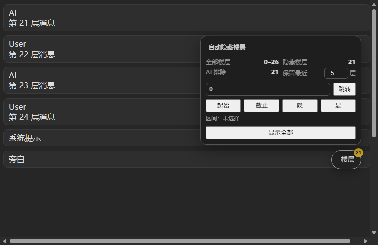

# 自动隐藏楼层（Auto Hide Floors）

一个适用于 **TauriTavern / SillyTavern 1.13+** 的第三方扩展：只保留最近 `N` 层消息

- GitHub：<https://github.com/xiaowujue00/SillyTavern->

聊天右下角有一个「楼层」悬浮按钮，点开就是控制面板：

- **全部楼层**：当前聊天的楼层范围，例如 `0–27`
- **隐藏楼层**：界面当前隐藏的楼层数（自动 + 手动区间）
- **保留最近**：直接在这里输入 `N`，改完立即生效
- **楼号 + 跳转**：跳到指定楼层；如果目标被隐藏，会先临时展开
- **起始 / 截止**：用楼号设置一个区间
- **隐 / 显**：隐藏或恢复这个区间；不选区间时点“显”会清空当前聊天的手动区间
- **显示全部 / 恢复折叠**：临时显示全部楼层，或恢复自动折叠
